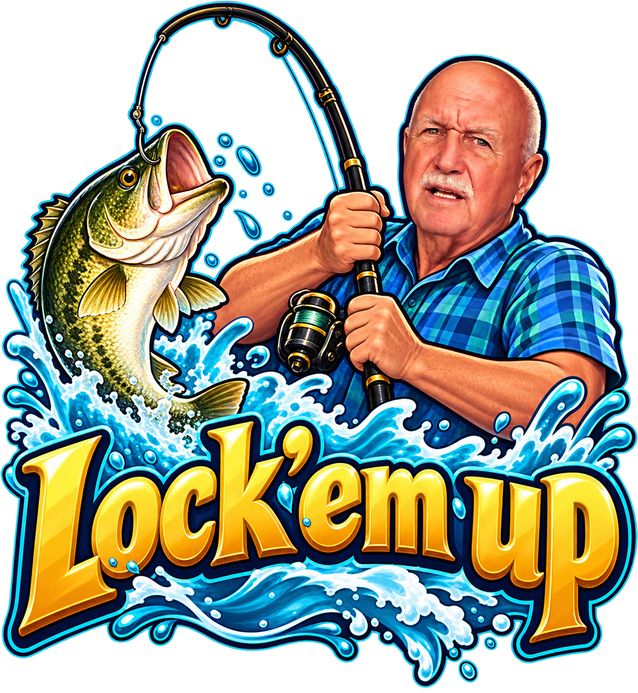

# Lock'em up 🎣



A meme-inspired browser game starring Norman Taylor. Spot the fishers, catch them in the act, and **lock ’em up!**

Play for a high score and compete for a place on the leaderboard.

## Tech Stack

- **Game:** Static HTML, CSS, and JavaScript
- **Leaderboard:** Serverless API backed by Postgres
- **Hosting:** Vercel

## Project Structure

```text
.
├── image.png            # Game logo
├── public/
│   └── index.html       # Game
└── api/
    └── leaderboard.js   # Leaderboard API
```

## Deploy to Vercel

1. Push this repository to GitHub and import it into Vercel, or run `npx vercel` from the project folder.
2. In **Project → Settings → Environment Variables**, add `DATABASE_URL` with your Postgres connection string.
3. Deploy and start playing!

The `scores` table is created automatically on the first leaderboard API request.

> Keep your database connection string private. Never commit it to the repository.

## Inspiration

Inspired by the Norman Taylor “Lock ’em up” meme. An unofficial fan project made for fun.
